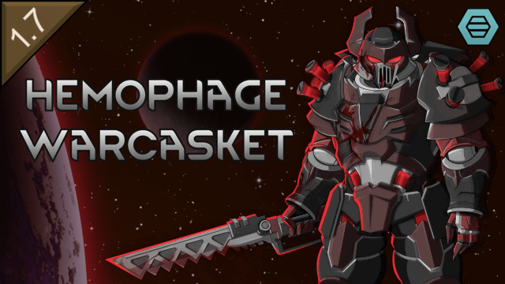

# Hemophage Warcasket

> A RimWorld mod adding a sanguophage warcasket set for Vanilla Factions Expanded - Pirates

<!-- Steam badges, added on first Workshop publish with WORKSHOP_ID from About/PublishedFileId.txt:

-->

## About

Vanilla Factions Expanded - Pirates lets you weld a pawn into a warcasket, a steel shell
customized part by part at the foundry, with a range of sets that carries a colony from the
industrial era into the late game. This mod adds one more set to that range.

The Hemophage is a 10th-generation warcasket made for sanguophages, and for any other pilot
with Biotech's hemogenic gene. It runs on the hemogen in its pilot's blood. A pilot without the
gene gets an ordinary spacer warcasket.

The mod is in development: the three pieces are in with their art and the standard stats and
costs of a spacer warcasket. The armor's and the shoulders' abilities and the pilot's work types
are built. The helmet's feature below is the design and is not built yet.

## Features

### The Set

Armor, shoulder pads and helmet, welded on at VFE Pirates' warcasket foundry and unlocked by its
spacer warcaskets research. Mix and match the pieces with VFE Pirates' own sets as you please.

- **Armor:** An ability that spends the pilot's hemogen quickly to make them much faster and
  stronger for a short time
- **Shoulders:** An ability that tears a limb off an enemy, after which a hemogenic pilot
  drains hemogen from the wound. The shoulders hold two strikes and reload with components
- **Helmet:** Shields a pilot who is sensitive to sunlight and steadies one who is afraid of
  fire, with the heaviest plating of the set
- **Mod settings** for how fast the armor spends hemogen and what it gives in return, the
  shoulders' strike capacity, reload cost, casting time, drain and targets, a steady glow
  in place of the pulse, and the helmet's protection from sunlight and from fire terror
- **Spacer-tier plating with extra heat protection, and a ranged shield** on VFE Pirates'
  10th-generation chassis
- **Built on VFE Pirates** rather than beside it: the foundry, entombing, customization and
  removal surgery all apply unchanged

### Enabled work types

VFE Pirates' warcaskets block all skilled and intellectual labor. The Hemophage's pilot keeps
intellectual work, so they can still research and hack. The mod settings can block it again, or
enable any of the other work a warcasket blocks.

## Requirements

- **RimWorld 1.6** or **1.7**
- **Biotech DLC**
- **Vanilla Factions Expanded - Pirates**, which itself requires **Vanilla Expanded Framework**
- **Harmony**, downloaded automatically from the Steam Workshop if you don't have it

## Installation

### Steam Workshop (Recommended)

Coming with the first release.

### Manual Installation

1. Download the latest release from the [Releases](https://github.com/sam-hunt/HemophageWarcasket/releases) page
2. Extract the `HemophageWarcasket` folder to your RimWorld `Mods` directory:
   - **Windows**: `C:\Program Files (x86)\Steam\steamapps\common\RimWorld\Mods\`
   - **Mac**: `~/Library/Application Support/Steam/steamapps/common/RimWorld/RimWorldMac.app/Mods/`
   - **Linux**: `~/.steam/steam/steamapps/common/RimWorld/Mods/`
3. Enable the mod in RimWorld's mod menu, after Vanilla Factions Expanded - Pirates
4. Restart RimWorld

## Compatibility

- **Safe to add** to existing saves.
- **Not safe to remove** from saves while a pawn is welded into the set.
- **Save Our Ship 2 / Universum**: EVA rated under exactly the same rules as VFE Pirates' own sets.
- **Vanilla Gravship Expanded**: follows its vacuum-resistance rules for warcaskets; there is no
  other VGE integration.
- **Vanilla Races Expanded - Sanguophage**: built-in support. The helmet covers its dangerous UV
  sensitivity. An animalfeeder pilot drains hemogen from animals and a sanguofeeder pilot from
  other sanguophages, each with that mod's own effects on the pilot. An aggressive pilot who
  becomes a hemohunter dismembers instead of biting while the shoulders have strikes left,
  and hunts whatever its feeding genes feed on as well: animals for an animalfeeder, other
  sanguophages for a sanguofeeder and human corpses for a corpsefeeder. Mod settings can turn
  off either.
- **Combat Extended**: built-in patch. CE armor values, bulk, carry capacity and shield in line
  with VFE Pirates' spacer sets and a helmet sealed against CE smoke.
- **Warcaskets can work!, Warcaskets can haul!, Hardworking Warcaskets**: compatible. Whatever
  these open for VFE Pirates' warcaskets they open here too.

## Contributing

Bug reports and feature requests welcome on [GitHub Issues](https://github.com/sam-hunt/HemophageWarcasket/issues).
Please attach any relevant logs/stack traces/mod lists etc.

Translations are welcome - see [CONTRIBUTING.md](CONTRIBUTING.md).
For development setup, see [CLAUDE.md](CLAUDE.md).

## Credits

**Author**: Sam Hunt ([@sam-hunt](https://github.com/sam-hunt))

**Art**: [IcingWithCheeseCake](https://steamcommunity.com/profiles/76561198094174176/myworkshopfiles/?appid=294100)

**Built With**:

- [Harmony](https://github.com/pardeike/Harmony) by Andreas Pardeike - Runtime patching library
- RimWorld modding API, community examples

**Special Thanks**:

- The [Vanilla Expanded team](https://steamcommunity.com/sharedfiles/filedetails/?id=2723801948) for Vanilla Factions Expanded - Pirates
- [Ludeon Studios](https://ludeon.com) for RimWorld and modding API
- [The RimWorld modding community](https://steamcommunity.com/app/294100/workshop/) for inspiration
